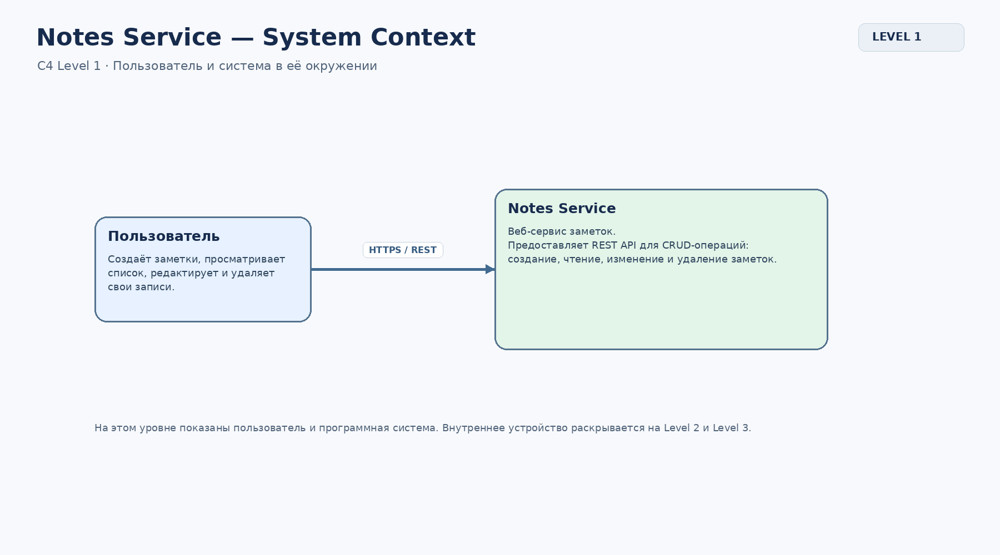
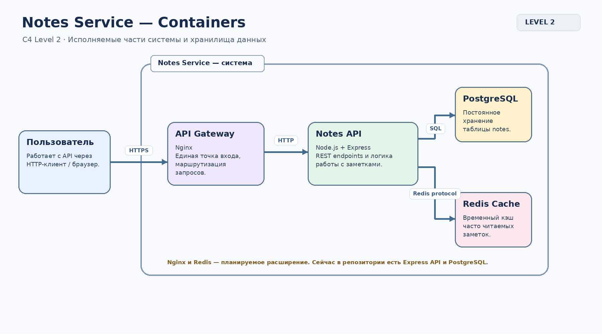
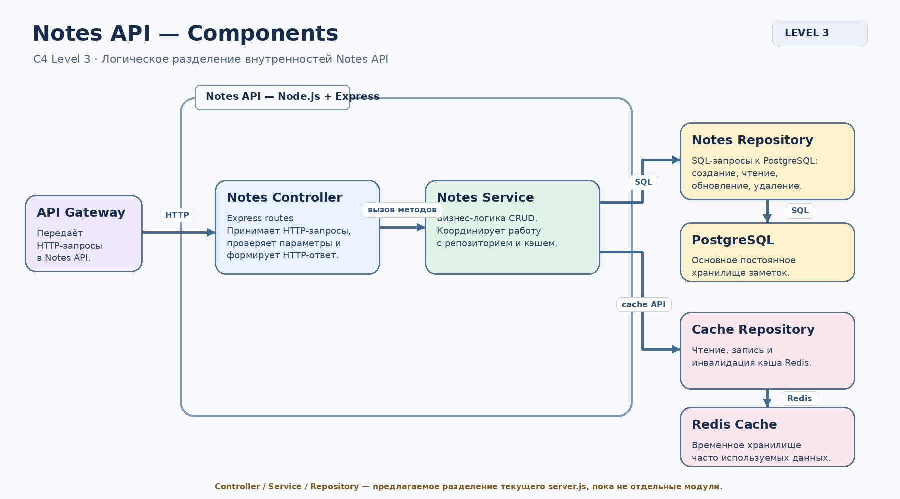

Отчет по лабораторной работе: Архитектура 


## Архитектура системы (C4)

Архитектура Notes Service описана на трёх уровнях модели C4.

### Level 1 — System Context


### Level 2 — Container


### Level 3 — Component


Подробное описание компонентов, взаимодействия и обоснование Redis Cache: [docs/architecture/architecture.md](docs/architecture/architecture.md).

Редактируемые исходники Draw.io, PNG-экспорты и общий PDF находятся в `docs/architecture/`.

# Notes Service — архитектура программного сервиса заметок

## 1. Описание проекта

**Notes Service** — REST API-сервис для создания, просмотра, редактирования и удаления текстовых заметок.

Основная задача проекта — предоставить пользователю удобный программный интерфейс для управления заметками и обеспечить их надёжное хранение в базе данных.

Архитектура проекта спроектирована с использованием **C4 Model**. Для описания системы подготовлены три уровня диаграмм:

- Level 1 — System Context;
- Level 2 — Container;
- Level 3 — Component.

В качестве основной базы данных выбрана PostgreSQL. В качестве дополнительного компонента целевой архитектуры предусмотрен Redis Cache. Для организации единой точки входа и маршрутизации запросов предусмотрен API Gateway на базе Nginx.

## 2. Используемые технологии

| Технология | Назначение |
|---|---|
| Node.js | Среда выполнения серверного приложения |
| Express.js | Создание REST API и обработка HTTP-запросов |
| PostgreSQL | Основное постоянное хранилище заметок |
| Redis | Дополнительный кэш часто запрашиваемых данных в целевой архитектуре |
| Nginx | API Gateway для приёма и перенаправления запросов в целевой архитектуре |
| Docker | Контейнеризация приложения и базы данных |
| Docker Compose | Совместный запуск контейнеров |
| Draw.io | Создание и редактирование архитектурных диаграмм |
| C4 Model | Многоуровневое описание архитектуры системы |

## 3. Функциональность сервиса

Сервис поддерживает основные CRUD-операции:

- **Create** — создание новой заметки;
- **Read** — получение списка заметок или одной заметки по идентификатору;
- **Update** — изменение существующей заметки;
- **Delete** — удаление заметки.

Каждая заметка содержит:
- `id` — уникальный идентификатор;
- `title` — заголовок;
- `content` — текст заметки.

## 4. Архитектура системы (C4 Model)

### 4.1. Level 1 — System Context

Контекстная диаграмма показывает систему Notes Service с точки зрения внешнего пользователя.

Пользователь отправляет запросы к сервису через HTTP-клиент. Система принимает запросы и предоставляет возможность управлять заметками.

На этом уровне отображаются границы программной системы и её взаимодействие с внешними участниками. Внутреннее устройство приложения и базы данных не раскрывается.


Исходный файл: `docs/architecture/diagrams/c4-context.drawio`.

### 4.2. Level 2 — Container

Диаграмма контейнеров раскрывает основные части системы и способы их взаимодействия.

В целевой архитектуре предусмотрены следующие контейнеры:

**1. API Gateway (Nginx)**

Единая точка входа для запросов пользователя. Принимает HTTP-запросы и перенаправляет их в Notes API. В дальнейшем через него можно организовать маршрутизацию, централизованную обработку запросов и дополнительные механизмы защиты.

**2. Notes API (Node.js + Express)**

Серверное приложение, которое обрабатывает REST-запросы и выполняет операции с заметками.

**3. PostgreSQL**

Основная реляционная база данных. Хранит заметки постоянно и является главным источником данных.

**4. Redis Cache**

Дополнительное хранилище в оперативной памяти. Предназначено для кэширования часто запрашиваемых данных, чтобы уменьшить количество повторных обращений к PostgreSQL.


Исходный файл: `docs/architecture/diagrams/c4-container.drawio`.

### 4.3. Level 3 — Component

Диаграмма компонентов показывает внутреннюю логическую структуру Notes API.

В целевой архитектуре выделены следующие компоненты:

**Notes Controller**

Принимает HTTP-запросы, обрабатывает параметры и формирует HTTP-ответы. В текущей реализации эту роль выполняют Express-обработчики в `server.js`.

**Notes Service**

Содержит бизнес-логику работы с заметками. Координирует выполнение операций и взаимодействие с хранилищами.

**Notes Repository**

Отвечает за взаимодействие с PostgreSQL и выполнение SQL-запросов.

**Cache Repository**

Отвечает за операции с Redis: получение данных из кэша, сохранение данных и очистку устаревших записей.

PostgreSQL и Redis находятся за пределами границы Notes API, поскольку являются отдельными хранилищами данных.



Исходный файл: `docs/architecture/diagrams/c4-component.drawio`.

## 5. Взаимодействие компонентов

Пример получения списка заметок в целевой архитектуре:

1. Пользователь отправляет HTTP-запрос на получение заметок.
2. API Gateway принимает запрос и перенаправляет его в Notes API.
3. Notes Controller обрабатывает запрос и передаёт управление Notes Service.
4. Notes Service обращается к Cache Repository для проверки наличия данных в Redis.
5. Если данные найдены в кэше, они возвращаются без обращения к PostgreSQL.
6. Если данных в кэше нет, Notes Service получает их через Notes Repository из PostgreSQL.
7. Полученные данные сохраняются в Redis для последующих запросов.
8. Результат возвращается пользователю через API.

При изменении или удалении заметки соответствующие данные в кэше должны обновляться или удаляться, чтобы избежать выдачи устаревшей информации.

## 6. Обоснование архитектурных решений

### PostgreSQL

PostgreSQL выбрана в качестве основной базы данных, поскольку она обеспечивает надёжное постоянное хранение информации, поддерживает SQL-запросы, ограничения целостности и транзакции.

### Redis Cache

Redis выбран как дополнительный компонент для ускорения повторного получения данных. Часто запрашиваемые заметки можно временно хранить в оперативной памяти.

PostgreSQL при этом остаётся основным источником данных. Кэш не заменяет базу данных и может быть восстановлен при необходимости.

### API Gateway (Nginx)

API Gateway используется как единая точка входа в систему. Он отделяет внешние запросы от внутренней реализации Notes API и позволяет централизовать маршрутизацию.

В дальнейшем это упрощает добавление новых серверных сервисов и настройку балансировки нагрузки.

### Разделение на компоненты

Разделение на Controller, Service и Repository помогает распределить ответственность между частями приложения:

- Controller отвечает за HTTP-взаимодействие;
- Service — за бизнес-логику;
- Repository — за работу с хранилищами.

Такую структуру проще тестировать, поддерживать и расширять.

## 7. Текущая реализация и целевая архитектура

В текущем репозитории реализованы:

- серверное приложение на Node.js;
- REST API на Express;
- подключение к PostgreSQL через библиотеку `pg`;
- создание таблицы `notes` при запуске приложения;
- CRUD-маршруты для работы с заметками;
- Dockerfile и Docker Compose для контейнерного запуска приложения и базы данных.

В текущей реализации SQL-запросы находятся непосредственно в обработчиках `server.js`.

**В целевой архитектуре дополнительно предусмотрены:**

- API Gateway на базе Nginx;
- Redis Cache;
- отдельный слой Notes Service;
- Notes Repository;
- Cache Repository.

Эти элементы представлены на архитектурных диаграммах как планируемое развитие системы. Они не должны восприниматься как уже реализованные функции текущего исходного кода.

## 8. Запуск проекта

Для запуска необходимы установленные Docker и Docker Compose.

В корневой папке проекта выполните:

```bash
docker compose up --build
```

После запуска API будет доступен на порту `8080`, а PostgreSQL — на порту `5432`.

Остановить контейнеры можно командой:

```bash
docker compose down
```

## 9. REST API

| Метод | Адрес | Назначение |
|---|---|---|
| POST | `/notes` | Создание заметки |
| GET | `/notes` | Получение всех заметок |
| GET | `/notes/:id` | Получение заметки по ID |
| PUT | `/notes/:id` | Изменение заметки |
| DELETE | `/notes/:id` | Удаление заметки |

Пример тела запроса для создания заметки:

```json
{
  "title": "Моя заметка",
  "content": "Текст заметки"
}
```

## 10. Структура архитектурных материалов

```text
docs/
└── architecture/
    ├── architecture.md
    ├── architecture.pdf
    └── diagrams/
        ├── c4-context.drawio
        ├── c4-context.png
        ├── c4-container.drawio
        ├── c4-container.png
        ├── c4-component.drawio
        └── c4-component.png
```

Файлы `.drawio` предназначены для редактирования диаграмм, PNG — для просмотра, PDF — для представления архитектурной документации в едином документе.

## 11. Итог

В рамках проекта описана архитектура Notes Service с использованием C4 Model на трёх уровнях детализации. Определены основные контейнеры, внутренние компоненты, хранилища данных и направления взаимодействия между ними.

Выбранная архитектура позволяет отделить пользовательские запросы от внутренней бизнес-логики и работы с данными, а также предусматривает возможность дальнейшего расширения системы за счёт кэширования и API Gateway.


